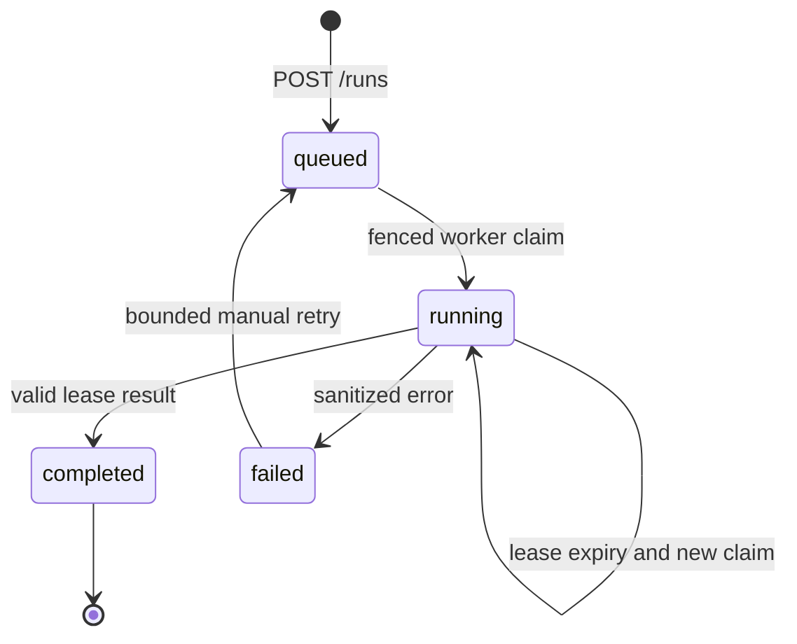

# ADR · B01–B03 Agent Task API

## Architecture

HTTP accepts a task, stores an immutable canonical payload with a tenant/key unique constraint, and returns a receipt. Independent offline worker claims the job and executes the P1 grounded team. HTTP never blocks on model execution.

## DB invariants

- `UNIQUE(tenant_id, request_key)` is enforced by SQLite.
- Canonical request fingerprint includes actor, question and execution limits; same key with changed data returns 409.
- `BEGIN IMMEDIATE`/COMMIT/ROLLBACK make insertion and state transitions atomic.
- Worker uses `claim_token` and `lease_until`; an expired/old worker cannot commit DB results.
- Stored error codes are generic, never raw private trace or exception text.

## Security

- Token-to-MemoryScope mapping happens on the server. Tenant scope is never a model tool argument.
- Fake static demo tokens do not substitute OAuth/OIDC. Do not publicly expose port 8000.
- All execution uses fictional read-only policy tools. No external payment effects are allowed.

## Non-guarantees

- SQLite claims are at-least-once *execution*: an expired worker may rerun work. Fencing is not external exactly-once effects.
- PostgreSQL, outbox, broker, lease expiry terminal cleanup, TLS, audit, quota and secret storage are future work.

## Tests

See `projects/p2_cloud_runtime/tests/test_task_api.py`: transaction contention, replay conflict, identity scoping, worker lifecycle, fencing, failure and retries.

References: https://fastapi.tiangolo.com/tutorial/testing/ and https://docs.python.org/3/library/sqlite3.html
