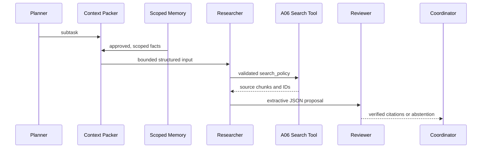

# A08–A10 · Context / Memory / Handoff Contracts

## A08 Context

We pack JSON with coordinator policy, goal and an array of untrusted data blocks; each block has kind, source_id, content and trust marker. Blocks are selected by priority and only included whole.

- Enforce a deterministic serialized **character** limit; it is not token-accurate.
- Always preserve core task and local instructions, reject if core alone exceeds the budget.
- Drop over-budget whole blocks; return selected/dropped source IDs for audit.
- Never transform retrieved text into actual developer/system messages or claim that this defeats prompt injection.

## A09 Memory

- SQLite primary key: (tenant_id, user_id, key). The server creates MemoryScope, never the LLM.
- Writes require explicit_user or operator_approved provenance. No agent model outputs are automatically memorized.
- TTL bounds, revision counter, list ordering, deletion, parameterized SQL.
- Memory is serialized as untrusted context. No encryption or production identity service in this MVP.

## A10 Handoffs

Planner → Researcher → Reviewer → Coordinator are the only allowed transitions. Every task produces three handoff audit events.

- Planner splits at semicolon / 'and', capped to at most three tasks.
- Researcher uses A04 loop and A06 tool to acquire tenant-scoped evidence.
- Reviewer uses A07 strict exact-source quotation verifier; fabricated source IDs are rejected.
- Coordinator surfaces supported, partial or insufficient_evidence status and never claims full coverage after partial failure.
- Before running, coordinator checks handoff budget; each Researcher additionally has model/tool call budgets.

## Future work

Actual MCP SDK Client/Server, authenticated tool scopes, P2 durable checkpoints, independent LLM planner/reviewer, enterprise memory governance and semantic entailment evaluation are **not implemented**.

