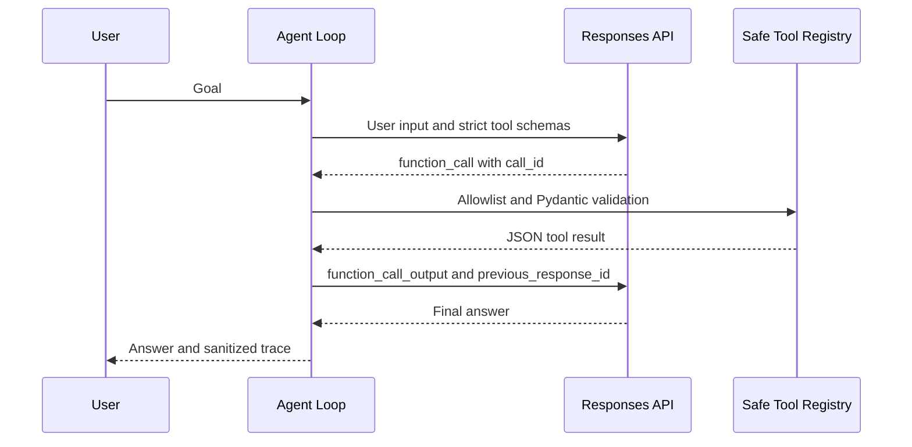

# P1 · Mini Agent Harness

**Problem:** 让模型的工具动作在可信执行边界中完成多步骤任务。

## MVP（可运行参考）

- `agent_harness.models`：Action / Trace 结果模型。
- `agent_harness.tools`：明确 allowlist 的工具执行器。
- `agent_harness.planner`：离线规则型 Planner（不是 LLM）。
- `agent_harness.loop`：Agent Loop、预算与停止逻辑。
- `agent_harness.context`：最近观察结果截断；非生产 Context Engineering。
- `agent_harness.memory`：仅内存多租户隔离存储。
- `agent_harness.security`：最小租户等值检查。

## 运行

```bash
PYTHONPATH=projects/p1_agent_harness/src python -m agent_harness.demo
python -m pytest projects/p1_agent_harness/tests
```

## 进阶功能占位

- [ ] 真实 LLM Adapter、结构化 ToolCall 参数验证
- [ ] 混合 RAG、来源校验与动态上下文压缩
- [ ] MCP client / server、Multi-agent handoff
- [ ] 持久 Memory、失败恢复、模型输出安全校验

## 退出标准

至少 20 个合成任务、工具授权单测、终止预算测试、完整轨迹、可重放失败案例；写明模型行为非确定性的控制方法。

---

## A01–A04 · Live Responses API Agent (new)

这里新增可使用真实 OpenAI 模型的版本，但默认仍保持完全离线的测试路径。

### 运行真实模型

```bash
python -m pip install -e '.[dev,llm]'
export OPENAI_API_KEY='your-own-api-key'
export OPENAI_MODEL='gpt-5-mini'
PYTHONPATH=projects/p1_agent_harness/src python -m agent_harness.live_demo --goal "Look up the 'refund' policy"
```

**该命令会产生实际的 API 费用；CI 没有使用真实密钥或付费模型。**

### 源码对应

| Unit | Files | Focus |
|---|---|---|
| A01 | llm.py, openai_adapter.py | ModelAdapter / Responses API / token cap |
| A02 | schemas.py, typed_tools.py | Strict JSON Schema + Pydantic validation |
| A03 | typed_tools.py | Read-only allowlist / call_id / tool feedback |
| A04 | live_loop.py | Observe-Decide-Act, budgets, sanitized trace |

### 实际执行路径



### 测试

```bash
python -m pytest projects/p1_agent_harness/tests tests/test_atomic_a01_a04.py
```

**隐私与合规：** 教学适配器显式设置 `store=True` 支持 `previous_response_id` 多轮链。不要发送真实客户数据、密钥和敏感轨迹。生产环境必须检查数据保留政策，并考虑无状态方案。

**局限：** 只允许只读政策查询；真实检索、多 Agent、OAuth、人工审批、分布式恢复尚未实现。参考 API 规范：[Function Calling](https://developers.openai.com/api/docs/guides/function-calling)。
